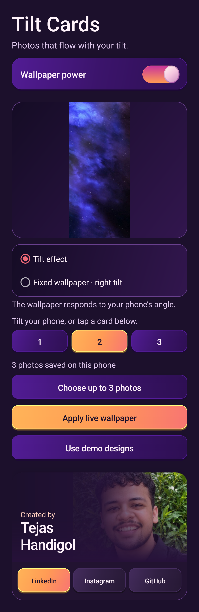

# Tilt Cards Creator

An Android live wallpaper app by Tejas Handigol. Tilt your phone to move between up to three wallpapers, or choose Fixed wallpaper and use a short right tilt to advance through your collection.

[Download the signed Android APK](downloads/Tilt-Cards-Creator-Portrait.apk?raw=true)

## Install

Open the APK on an Android phone, then open Tilt Cards Creator. Pick a wallpaper mode, add your photos, and tap **Apply live wallpaper**. Android controls the available home and lock screen placement options.

The package is `com.tejashandigol.tiltcards.creator`. This is version 1.16, build 18. The APK requires Android 9 or later.

## Screenshot



Tilt Cards Creator v1.16 with the sunset controls and Portrait Cover creator card.

## Features

- Tilt effect mode with a three-photo limit and animated transitions
- Fixed wallpaper mode with right-tilt cycling and repeatable photo imports
- Wallpaper power switch for motion tracking
- Local storage of original photos
- Portrait Cover creator card with profile links

## Build

Open the project in Android Studio with the Android 16 SDK and JDK 17 or later, or run `./gradlew assembleDebug`. The Gradle wrapper is included. The debug output uses your local debug signing key.

APK SHA-256

```
ae566e22f0736431702b58ed87f13fcf2a341604f8dda71ee4782b493c54a92d
```

[LinkedIn](https://in.linkedin.com/in/tejashandigol) · [Instagram](https://www.instagram.com/tejas__8055/) · [GitHub](https://github.com/tejas-ai)
